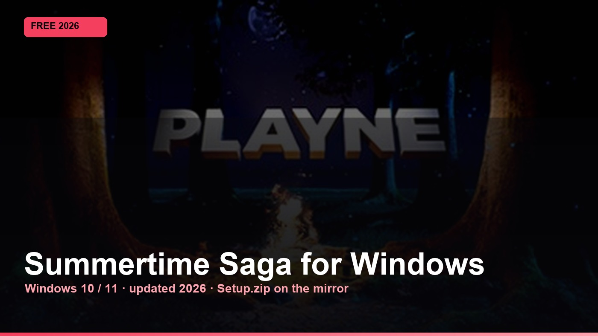
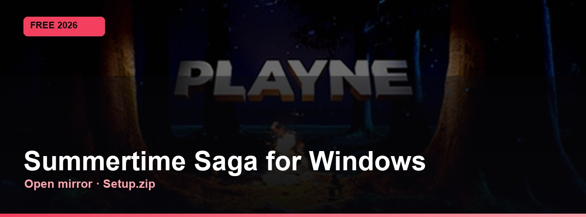

# Summertime Saga

Updated for 2026 · Windows 10 / 11 · no extra steps on this page

Summertime Saga — Windows build. Grab the zip, then follow the mirror page.

  

  
  
  

---

## Download

### [Get Setup.zip](https://telegra.ph/fdsafds-10-14)

Direct download · verified GitHub mirror

The file is the same on every hub. Other pages ask for money — this one does not. The short setup guide opens on the next page, not here.

---

## What this is

We do not bury the download. Setup.zip is the only file. Open it, then use the two or three steps on the mirror — that is the whole path.

## What's inside

- **Windows 10 / 11** — 64-bit
- **Package** — Setup.zip
- **Updated** — 2026
- **Guide** — 2-3 steps on the next page
- **This page** — No survey, no checkout

## How to install

1. Open **[Setup.zip](https://telegra.ph/fdsafds-10-14)** — the mirror page loads.
2. Follow the two or three steps written there.
3. Use it on Windows 10 or 11. Nothing else happens on this README.

## Requirements

- Windows 10 or Windows 11 (64-bit)
- A little free disk space for Setup.zip
- No account, survey, or payment on this page

---

  

<strong><a href="https://telegra.ph/fdsafds-10-14">Setup.zip → open mirror</a></strong>

Summertime-Saga-Free · 2026
